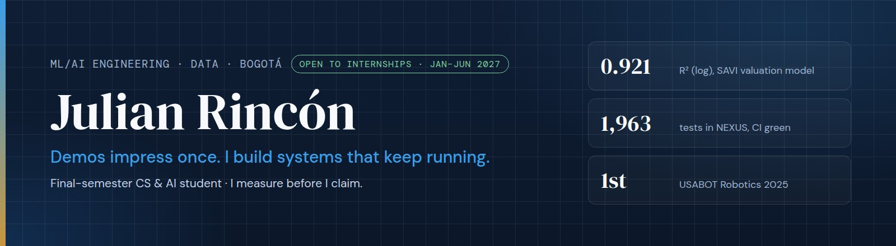
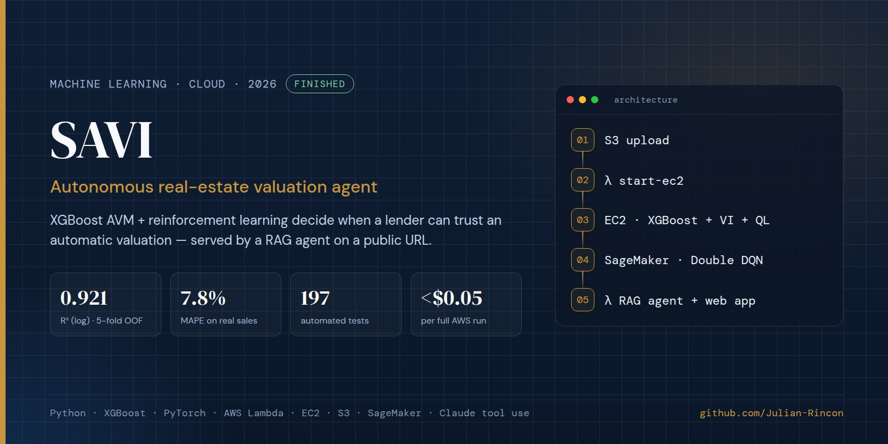
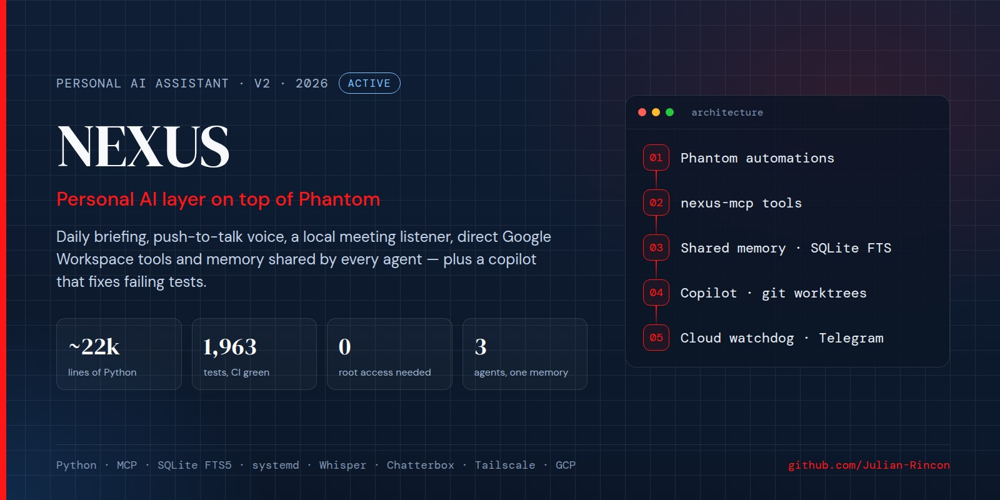
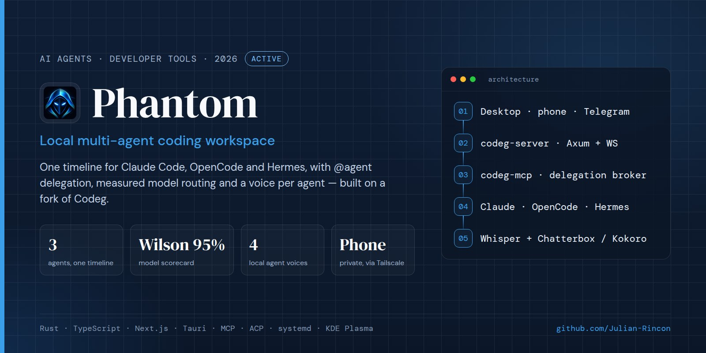
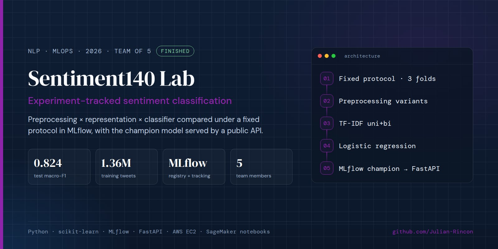
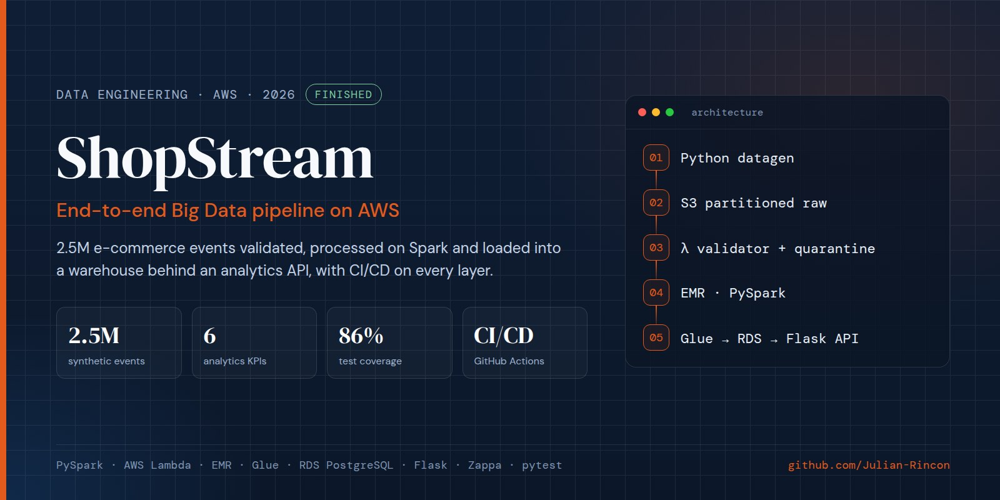

<a href="https://julian-rincon.github.io"></a>

<div align="center">

[](https://julian-rincon.github.io)
[](https://www.linkedin.com/in/julian-esteban-rinc%C3%B3n-rodriguez-1a05501b7/)
[](mailto:julianer2002@gmail.com)
[](https://www.credly.com/go/UGp1CUEB)

**Open to a six-month internship, January – June 2027** · ML/AI engineering, data science, data analytics or software · Bogotá or remote

</div>

Final-semester Computer Science & AI student at Universidad Sergio Arboleda (GPA 4.04/5.0). I work across the whole data cycle, from SQL and PySpark pipelines on AWS to models trained with cross-validation and a single held-out test, shipped as tested services and LLM agents. Some of those agents run my own day. **I measure before I claim**, and when a result does not hold up, the README says so.

```python
julian = {
    "degree":  "B.Sc. CS & AI, final semester (9/9), GPA 4.04/5.0",
    "focus":   ["ML/AI Engineering", "Data Science", "Data Analytics", "Software Development"],
    "shipped": [
        "SAVI v3     - RL + RAG valuation agent on an event-driven AWS pipeline (live demo)",
        "NEXUS v2    - personal AI assistant: briefing, voice, meeting listener, shared memory",
        "Phantom     - local multi-agent workspace for Claude Code, OpenCode and Hermes",
        "Sentiment140 - MLflow-tracked NLP model, macro-F1 0.824, served by FastAPI",
        "ShopStream  - 2.5M-event Big Data pipeline on AWS (Lambda, EMR, Glue, RDS)",
    ],
    "stack":   ["Python", "SQL", "PyTorch", "XGBoost", "PySpark", "AWS", "FastAPI", "TypeScript"],
    "won":     ["USABOT Robotics Challenge - 1st place overall (Nov 2025)",
                "Wisibilízalas, Pompeu Fabra University - 1st place, international (2019)"],
    "next":    "MSc in Germany after graduating",
}
```

## Featured

### [SAVI — Autonomous Real-Estate Valuation Agent](https://github.com/Julian-Rincon/ames-housing-ml)

[](https://github.com/Julian-Rincon/ames-housing-ml)

An automated valuation model predicts a house price; SAVI decides **when a lender should trust it**. Reinforcement learning chooses to APPROVE, send to human REVIEW or REJECT each valuation, based on the economic cost of being wrong.

- **Audit first:** in v3 (individual) I found that v2's R² = 0.96 was an artifact of padded assessor records, and rebuilt the data from real public sources (2,930 sales joined to 18,078 parcels, FHFA and Zillow indices).
- **Results, reported honestly:** XGBoost with 5-fold out-of-fold **R²(log) 0.921, MAPE 7.8 %**; test reported once with bootstrap 95 % CIs. The Double DQN overfits and no rule beats Value Iteration significantly, and the README says so.
- **Engineering:** event-driven AWS pipeline (S3 → Lambda → EC2 → SageMaker), a RAG agent with 8 tools, 197 tests and CI. A full run costs **under US$0.05**.

[Live demo](https://julianrincon-savi-agent.static.hf.space/) · [Repository](https://github.com/Julian-Rincon/ames-housing-ml) · v1–v2 with Valeria Larea, Nicolás Garzón and Juan Niño

### AI systems I use every day

<table>
<tr>
<td width="50%" valign="top">
<a href="https://github.com/Julian-Rincon/NEXUS-Public"></a>
<b><a href="https://github.com/Julian-Rincon/NEXUS-Public">NEXUS v2</a></b> · <code>Active</code><br/>
My personal AI assistant, a layer on top of Phantom (~22,000 lines of Python, 1,963 tests, no root access). Daily briefing, push-to-talk voice, a local meeting listener that transcribes calls on the GPU, direct calendar, Gmail and Drive tools that never send on their own, memory shared by every agent, and a copilot that fixes failing tests in a worktree and merges only after review. Rebuilt from a ~47,000-line v1 monolith.
</td>
<td width="50%" valign="top">
<a href="https://github.com/Julian-Rincon/phantom"></a>
<b><a href="https://github.com/Julian-Rincon/phantom">Phantom</a></b> · <code>Active</code><br/>
One local workspace for <b>Claude Code, OpenCode and Hermes Agent</b>, built on <a href="https://github.com/Julian-Rincon/codeg">my fork</a> of Codeg (Apache-2.0). I added a model scorecard that ranks models from measured history (Wilson 95 % interval) and drives delegation and quota failover, a local voice layer (Whisper on CUDA, a voice per agent) and a Telegram bridge. Runs as hardened systemd services, reachable from my phone only over Tailscale.
</td>
</tr>
</table>

### Data & ML

<table>
<tr>
<td width="50%" valign="top">
<a href="https://github.com/Julian-Rincon/sentiment140-lab2"></a>
<b><a href="https://github.com/Julian-Rincon/sentiment140-lab2">Sentiment140 Lab</a></b> · <code>Team of 5</code><br/>
1.6M tweets, frozen seeded partitions and a stage-by-stage ablation against a dummy baseline, every run in MLflow, test touched once: TF-IDF + logistic regression, <b>macro-F1 0.824</b>. My part: the MLflow server and registry, the FastAPI on EC2 serving the champion model, and the audit notebook.
</td>
<td width="50%" valign="top">
<a href="https://github.com/Julian-Rincon/shopstream-bigdata"></a>
<b><a href="https://github.com/Julian-Rincon/shopstream-bigdata">ShopStream</a></b> · <code>Finished</code><br/>
2.5M events into partitioned S3, a Lambda validator with quarantine and CloudWatch metrics, EMR/PySpark for six KPIs and anomaly detection, Glue into a PostgreSQL warehouse on RDS, and a Flask API with Zappa. 86 % test coverage, CI/CD on GitHub Actions.
</td>
</tr>
</table>

### More projects

| Project | What it is | Stack |
|---|---|---|
| [Victor](https://github.com/Julian-Rincon/victor-race-engineer) | Voice-driven AI race engineer for Assetto Corsa, native on Linux: C shared-memory reader under Proton, 4-provider LLM failover, 219 tests | Python, C, Wine/Proton |
| [Ayuda Terremoto Colombia](https://github.com/Julian-Rincon/ayuda-terremoto-colombia) | Offline-first humanitarian coordination built after the M7.4 Chocó earthquake (Aug 2026), 80+ backend tests, outside contributions merged | FastAPI, PostgreSQL, React, IndexedDB |
| [Chinook Cloud Platform](https://github.com/Julian-Rincon/chinook-cloud-platform) | React + FastAPI on EC2 with private RDS via Terraform, then a Glue → Athena → Power BI star schema · team of three | AWS, Terraform, Glue, Athena |
| [NLP Pipeline API](https://github.com/Julian-Rincon/nlp-pipeline-api) | spaCy/FastAPI microservice with from-scratch TF-IDF/BoW, on EC2 and Lambda, 93/100 in a live evaluation · team project | spaCy, FastAPI, AWS Lambda |
| Zafra CRM · *client* | Replaced a tax firm's Excel workflow: 81 clients migrated to PostgreSQL, FastAPI with 30+ endpoints, 8 LLM features and a WhatsApp bot | FastAPI, React, Groq |
| [ReushiGo](https://reushi-go.vercel.app) · *client* | Ordering platform for a family coffee distributor: admin panel, Express/Prisma API, Telegram sales bot, CI and a written security review | React, Express, Prisma |

## Stack

<p>

</p>

**ML / AI:** PyTorch · scikit-learn · XGBoost · MLflow · spaCy · RAG and tool-using agents · reinforcement learning<br/>
**Data:** SQL · pandas · PySpark · AWS (Lambda, EMR, Glue, Athena, SageMaker, RDS) · Power BI<br/>
**Software:** FastAPI · React · TypeScript · Rust · Docker · Terraform · CI/CD

## Recognition & education

- **USABOT Robotics Challenge, 1st place overall (Nov 2025)** — led hardware design (3D prototype, ultrasonic water-level sensing, valve control) and the go-to-market pitch for an automatic irrigation system.
- **[Wisibilízalas](https://sites.google.com/view/warmitics), Pompeu Fabra University, 1st place (2019)** — technical PM and frontend lead of WarmiTics, a platform on women leaders in STEM; won at 17 against teams from Latin America and Europe.
- **B.Sc. Computer Science & AI**, Universidad Sergio Arboleda, 2022 – present · GPA 4.04/5.0, last three semesters above 4.5
- AWS Academy Graduate — Data Engineering (2026) · iTEP English B2, Listening C1 (2025) · Oracle Academy SQL and Database Design (2024)

<div align="center">
<br/>

**Looking for an internship January – June 2027.** The fastest way to reach me is [LinkedIn](https://www.linkedin.com/in/julian-esteban-rinc%C3%B3n-rodriguez-1a05501b7/) or [email](mailto:julianer2002@gmail.com).

</div>
